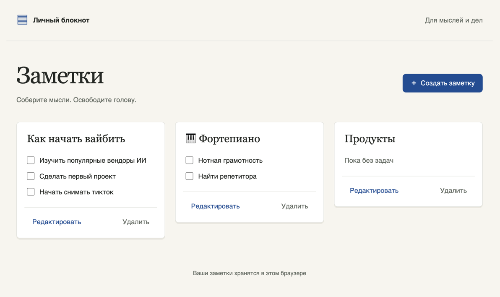

# Notes

A two-page personal notebook built with Nuxt 4, the Vue Composition API, strict TypeScript, Pinia, and SCSS. The interface is in Russian. Data stays in the user's browser.



## Getting started

```sh
docker-compose up --build
```

Open [the application](http://localhost:3000). Docker installs dependencies and builds the SPA. Nginx serves `index.html` for direct requests to `/notes/:id`. Press Ctrl+C to stop the application.

For local development, install Node.js 24.15 or later in the 24.x line and run the following commands.

```sh
npm ci
npm run dev
```

## Checks

```sh
npm run format:check
npm run lint
npm test
npm run typecheck
npm run generate
```

Run `npm run format` to apply Prettier. The lint command runs ESLint for scripts and Vue templates, then Stylelint for SCSS files and Vue style blocks.

## Architecture

- `app/domain/notes` contains the data model, validation, and reversible operations. History holds up to 50 operations, including field identities, text values, and task positions.
- `app/stores/notes.ts` owns the saved collection. `app/stores/editor.ts` owns an independent editing session. Components communicate user actions through typed events.
- `app/storage` manually reads and validates JSON with `schemaVersion: 1`. The saved collection in localStorage changes on Save, Delete, and task completion changes in home-page previews. Each editor route has a separate recovery draft in localStorage, so recovery remains available after closing and reopening the browser. Existing sessionStorage drafts are migrated when their editor route is opened. Draft writes are debounced by 500 ms and flushed on pagehide.
- Web Locks serializes collection updates across tabs. An existing note's presence is checked again while holding the lock. When Web Locks is unavailable, including HTTP access over a local network, an IndexedDB readwrite transaction serializes the synchronous collection updates. Note content remains in localStorage.

Continuous typing is grouped until the field loses focus or input pauses for 500 ms. The next editor action first commits any pending text operation. Ctrl/Cmd+Z and Ctrl/Cmd+Shift+Z control editor history outside text fields. Text fields retain the browser's native undo history.

Restoring a draft starts a fresh history. Empty fields are allowed while typing. Saving trims surrounding whitespace, removes tasks with blank text, and displays an error if the title is blank. A note may have zero tasks.

## Manual acceptance checks

1. Create a note, add tasks, and save it. Reload the editor using its direct URL.
2. Edit text and immediately toggle a checkbox. Successive Undo actions should revert the toggle, then the typing group. A new edit after Undo should clear Redo.
3. Edit a note and reload the page. Restore the draft, then use another draft to check the Discard action.
4. Open the same note in two tabs and delete it in one. The other tab should explain what happened and disable Save. Saving from the stale editor must never recreate the deleted note.
5. Navigate using only the keyboard. Check Tab/Shift+Tab inside dialogs, Escape dismissal, focus restoration, native text undo, and focus on the first invalid field when saving.
6. At a width of 320 CSS px and with text enlarged to 200%, check long titles and strings without spaces. All actions should remain accessible.
7. In Safari on an iPhone with Dynamic Island, open a long note. Collapse and expand the browser controls, add the last task, enter text, rotate the screen, open and close a dialog, correct a blank field at the start of the list, and save. The caret, errors, and both dialog buttons should remain reachable. Check VoiceOver and reading order.

## Verification results

Verified on November 3, 2026.

- Vitest passed all 27 tests. Strict TypeScript checking completed without errors.
- Docker dependency installation using `npm ci`, static generation, and Nginx startup succeeded. Direct editor URLs work.
- Chromium 156 and Playwright WebKit 27.2 passed creation, saving, reload, recovery, staying in the editor after a leave confirmation, Escape dismissal, validation, the 320 px layout, deletion from another tab, and unknown note IDs. These scenarios produced no JavaScript errors.
- Chromium and WebKit also passed checks for native undo, global undo/redo, dialog focus trapping, recovery preservation after Escape, text enlarged to 200%, and landscape orientation.
- Firefox verification remains incomplete. The downloaded build could not open its temporary profile in this environment.
- Safari on a physical iPhone, dynamic browser controls, the on-screen keyboard, and VoiceOver still require manual acceptance checks on a device. Playwright WebKit verification does not cover the iOS system interface.

The browser smoke test is included in the repository.

```sh
npx playwright install
npm run test:browser
# Select the available browser engines
BROWSERS=chromium,webkit npm run test:browser
node tests/browser/keyboard.cjs
node tests/browser/http-compatibility.cjs
```

Start the application at [localhost](http://localhost:3000) before running these tests. Use `BASE_URL` to specify another address. Tests use separate browser contexts and leave notes in your regular browser profile untouched.

## Publishing

The local Git history is ready for publication. Create an empty public GitHub or GitLab repository and add its remote URL.

```sh
git remote add origin <URL>
git push -u origin main
```
